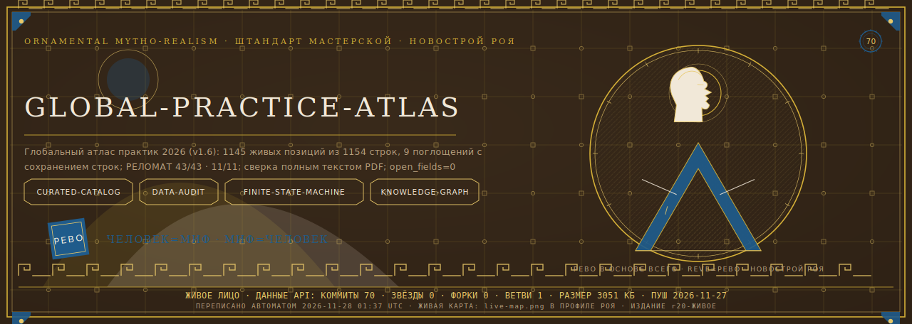
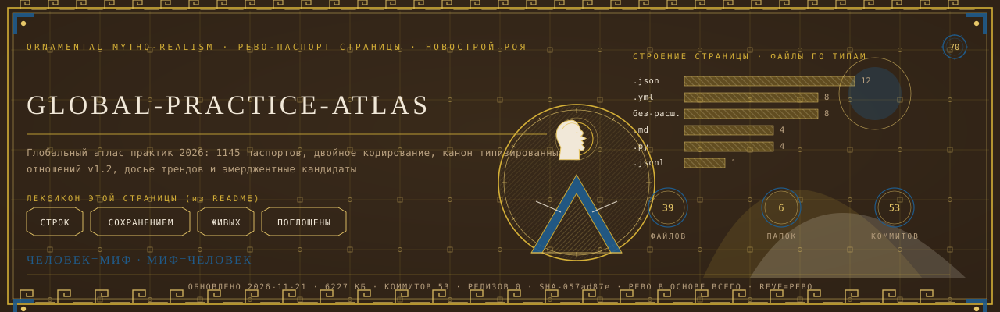

<!--ФОРЖ:ПАСПОРТ:НАЧАЛО-->

  

| ФАЙЛОВ | ПАПОК | КОММИТОВ | ОБНОВЛЕНО | РЕЛИЗОВ |
|---:|---:|---:|---|---:|
| 37 | 6 | 45 | 2026-11-21 | 0 |
<!--ФОРЖ:ПАСПОРТ:КОНЕЦ-->

# Глобальный атлас практик 2026 (Global Practice Atlas)

**ВЕРСИЯ:** v1.6 · **ДАТА:** 2026-11-20 · **ПАСПОРТОВ:** 1154 (1145 живых; 9 поглощены с сохранением строк) · **ЗРЕЛОСТЬ:** 100% (M1–M4)

## Что это

Паспортный слой каталога практик: 1045 позиций каталога (001–1045) + 100 кандидатов V2 (1046–1154 (1145 живых; 9 поглощены с сохранением строк)).
Двойное кодирование: словарь атласа (Тренд/Практика/Технология/Метод/…) + 12 классов V2; шкала зрелости
атласа и M1–M4 с калибровкой по медиане группы.

## Канон типизированных отношений (v1.6)

Не объединять категорию с методом, свойство с инструментом, экземпляр с классом; похожее название ≠
одинаковая сущность — сравниваются предмет, механизм, назначение и границы применимости. Большинство
«похожих» позиций получают не MERGE, а типизированное отношение из словаря:
**SAME, IS-A, PART-OF, TOOL-OF, METHOD-OF, RELATED, COMPLEMENTARY, MEMBER-OF, INSTANCE, FRAMEWORK**.
MERGE присваивается только после SAME-подтверждения полными формулировками.

Исполнение канона — автомат **relomat** (см. соседний репозиторий): unittest 11/11, верификация строк
атласа 43/43, эмерджентные кандидаты 7/7.

## Состав

| Файл | Содержание |
|---|---|
| `data/passports.csv` | 1154 (1145 живых; 9 поглощены с сохранением строк) паспортов × 23 поля (UTF-8 BOM, ; ) |
| `data/passports.json` | passports + словарь 10 отношений + расхождения аудит-vs-V2 |
| `data/Global_Practice_Atlas_2026_Паспорта_практик.xlsx` | 8 листов: Сводка, Паспорта, Методология, Словари, Матрица тип×зрелость, Расхождения, Кандидаты V2 — отношения, CHANGELOG |
| `dossier/trends-2026-emergent.md` | Мировые тренды практик 2026 → эмерджентные кандидаты 1146–1151 (РЕЛОМАТ 7/7) |
| `CHANGELOG.md` | История версий |

## Решения v1.6

- Введён канон типизированных отношений (10 связей), словарь — в методологию и «Словари» книги Excel.
- Пересмотр v1.1: 4 фасетных MERGE (V2:907, 916, 919, 943) приняты как самостоятельные позиции
  (METHOD-OF/PART-OF); 4 точных совпадения (V2:918→915, 935→1011, 941→1003, 942→1004) помечены SAME
  с сохранением строк — поглощение после сверки полных формулировок.
- 96 кандидатов V2 приняты, 25 связей типизированы; зрелость 1154 (1145 живых; 9 поглощены с сохранением строк)/1154 (1145 живых; 9 поглощены с сохранением строк) (M1: 324 · M2: 674 · M3: 134 · M4: 13).
- Подтверждено покрытие тем роя: коннектомика (№601), предиктивная обработка (№611), сложные системы (№631).

## Источники

- V2-переработка (файл владельца, позиции 101–1000, 12 классов, калибровки)
- Реестр вердиктов аудита 001–200 (SAME/IS-A/PART-OF/TOOL-OF/RELATED/COMPLEMENTARY + правила дедупликации)
- Реестр домена A (001–100, 1001–1045), каталог-расширения 201–1000
- Тренды 2026: Stanford AI Index 2026, Gartner Top Strategic Technology Trends 2026, Deloitte Tech Trends 2026 (см. досье)

## Границы

- Кандидаты V2 и эмерджентные позиции — до полной проверки формулировок; SAME-строки сохраняются без поглощения.
- M-коды 901–1000 и 1021–1045 получены медианной калибровкой группы (метод в методологии книги Excel).
- Расхождения аудит-vs-V2 (21) не редактировались вручную — правило разрешения зафиксировано, итог отдаётся аудиту.

## Лицензия

MIT
